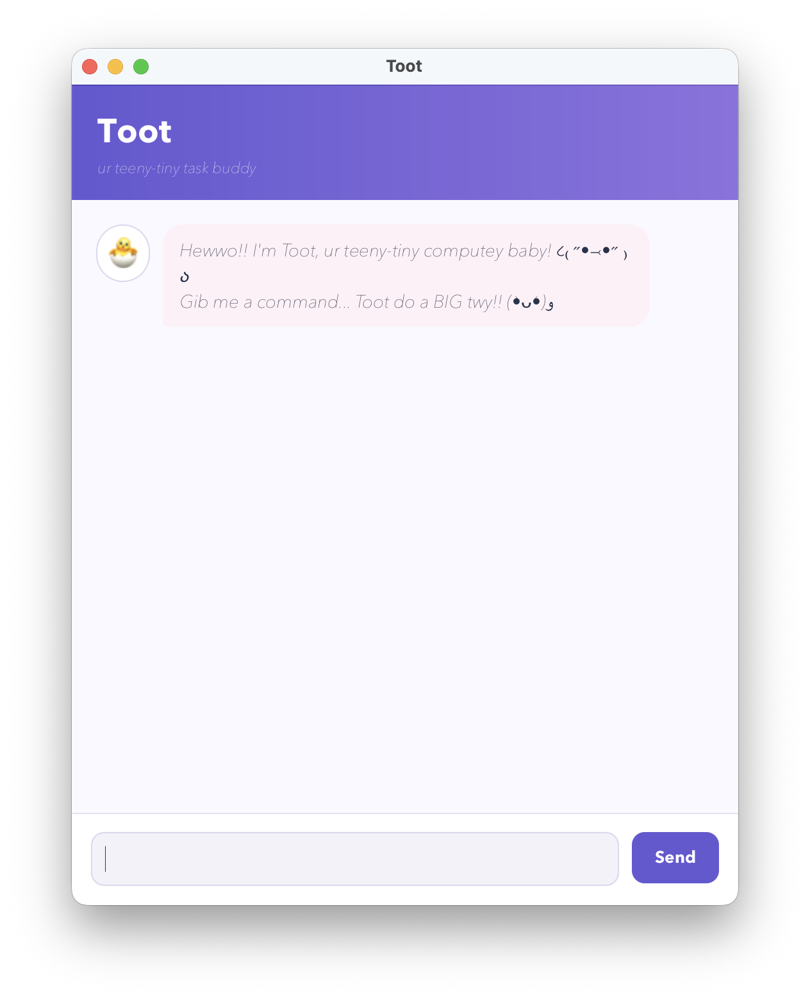

# Nova

A task tracker you talk to. Nova keeps todos, deadlines and events in a list,
saves them the moment they change, and answers in one line so you can get on
with the task rather than the tracker.



## Running it

Download `nova.jar` from the [latest release](https://github.com/dbs15329/ip/releases),
put it in an empty folder, and run:

```
java -jar "nova.jar"
```

Nova creates a `data/nova.txt` file beside the JAR to keep your tasks in.

Requires **Java 25**. On macOS use the Azul Zulu 25 build with JavaFX
(`sdk use java 25.0.3.fx-zulu`).

Type `help` in the app to see every command, or read the
[User Guide](https://dbs15329.github.io/ip/).

## Building from source

Prerequisites: JDK 25, and a JavaFX-capable distribution on macOS as above.

```
./gradlew run          # launch the GUI
./gradlew check        # compile, run the 142 JUnit tests, run Checkstyle
./gradlew shadowJar    # build build/libs/nova.jar
```

The console version is still there and is what the automated checks drive:

```
java -cp build/classes/java/main nova.Nova
```

## Acknowledgements

- Built from the [se-edu iP template](https://github.com/nus-cs2103-AY2627S1/ip)
  for CS2103/T, including its Gradle setup and Checkstyle configuration.
- Checkstyle rules are the ones published by
  [se-edu/addressbook-level3](https://github.com/se-edu/addressbook-level3/tree/master/config/checkstyle).
- The GitHub Actions workflow follows the one recommended in
  [se-edu/duke](https://github.com/se-edu/duke/blob/full-template/.github/workflows/gradle.yml).
- The GUI follows the structure taught in the
  [SE-EDU JavaFX tutorial](https://se-education.org/guides/tutorials/javaFx.html)
  (`Launcher`, `Main`, `MainWindow`, `DialogBox`), with its own layout and styling.
- Nova's avatar was generated for this project; no third-party images are used.

### Use of AI tools

Claude Code (Anthropic) was used extensively by me (dbs15329) throughout this
project, as an assistant for writing and refactoring code, tests, commit
messages and this documentation. Its use was not limited to particular files,
so it is cited here rather than in individual comments, per the course
[policy on reuse](https://nus-cs2103-ay2627-s1.github.io/website/admin/policies.html).
Every change was reviewed and accepted by me before being committed.
