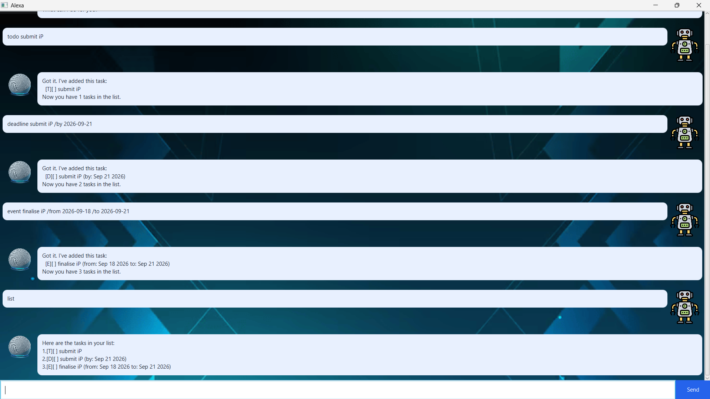

# Alexa User Guide

Alexa is a desktop task manager for recording to-dos, deadlines, and events.
Enter commands in the chat input and press <kbd>Enter</kbd> or click **Send**.
Alexa saves task-list changes automatically, so you can close and reopen the
application without manually saving.



## Quick start

1. Install Java 25.
2. Download `Alexa.jar` from the project's
   [Releases page](https://github.com/EdmundTan37/ip/releases).
3. Open a terminal in the folder containing the JAR and run:

   ```shell
   java -jar Alexa.jar
   ```

4. Type a command, for example `todo read book`, then press <kbd>Enter</kbd>.
5. Use `list` to view the current tasks.

## Command format

- Words in `UPPER_CASE` are values that you must replace. For example, replace
  `DESCRIPTION` in `todo DESCRIPTION` with `read book`.
- Dates use the ISO format `yyyy-MM-dd`, such as `2026-10-15`.
- Task numbers are positive whole numbers shown by `list`, starting from `1`.
- Command words are lowercase: use `todo`, not `TODO`.
- Extra spaces around a command or date marker are accepted.

## Features

### Add a to-do: `todo`

Adds a task without a date.

Format: `todo DESCRIPTION`

Example:

```text
todo read book
```

Alexa adds `[T][ ] read book` to the task list.

### Add a deadline: `deadline`

Adds a task due on a particular date.

Format: `deadline DESCRIPTION /by yyyy-MM-dd`

Example:

```text
deadline return book /by 2026-10-15
```

Alexa displays the deadline as `Oct 15 2026`.

### Add an event: `event`

Adds an event with a start and end date. The end date must be later than the
start date.

Format: `event DESCRIPTION /from yyyy-MM-dd /to yyyy-MM-dd`

Example:

```text
event project meeting /from 2026-10-16 /to 2026-10-17
```

### List tasks: `list`

Shows every task in the order it was added, with a one-based task number.

Format: `list`

### Find tasks: `find`

Shows tasks whose descriptions contain the supplied keyword. Matching ignores
letter case.

Format: `find KEYWORD`

Example:

```text
find book
```

This finds both `read book` and `return BOOK`.

### Mark a task as done: `mark`

Marks the task at the given list number as completed. A completed task is
displayed with `[X]`.

Format: `mark TASK_NUMBER`

Example: `mark 2`

### Mark a task as not done: `unmark`

Marks a completed task as incomplete again.

Format: `unmark TASK_NUMBER`

Example: `unmark 2`

### Delete a task: `delete`

Removes the task at the given list number. Remaining tasks are renumbered.

Format: `delete TASK_NUMBER`

Example: `delete 3`

### Exit Alexa: `bye`

Ends the console version of Alexa. In the graphical version, you can also
close the application window.

Format: `bye`

## Saving and loading tasks

Alexa saves automatically whenever a task is added, marked, unmarked, or
deleted. It loads saved tasks when it starts. The data file is created at
`data/alexa.txt`, relative to the folder from which Alexa runs, if it does not
already exist.

Avoid editing this file manually. Invalid data causes Alexa to start with an
empty task list and show a loading error.

## Input validation and duplicate tasks

Alexa shows errors in a visually distinct message and does not change the task
list when a command is invalid.

- A description cannot be empty or contain the `|` character.
- A deadline needs exactly one `/by` marker and a valid date.
- An event needs one `/from` marker, one `/to` marker, valid dates, and an end
  date later than its start date.
- `find` needs a non-empty keyword.
- `mark`, `unmark`, and `delete` need an existing task number.
- Alexa rejects a duplicate new task. Duplicates have the same task type,
  description, and applicable date fields; completion status does not matter.

For example, entering `todo read book` twice produces an error identifying the
existing task number. A to-do and a deadline with the same description are not
duplicates because they are different task types.

## Command summary

Action | Format | Example
--- | --- | ---
Add a to-do | `todo DESCRIPTION` | `todo read book`
Add a deadline | `deadline DESCRIPTION /by yyyy-MM-dd` | `deadline return book /by 2026-10-15`
Add an event | `event DESCRIPTION /from yyyy-MM-dd /to yyyy-MM-dd` | `event meeting /from 2026-10-16 /to 2026-10-17`
List tasks | `list` | `list`
Find tasks | `find KEYWORD` | `find book`
Mark a task | `mark TASK_NUMBER` | `mark 1`
Unmark a task | `unmark TASK_NUMBER` | `unmark 1`
Delete a task | `delete TASK_NUMBER` | `delete 1`
Exit | `bye` | `bye`
